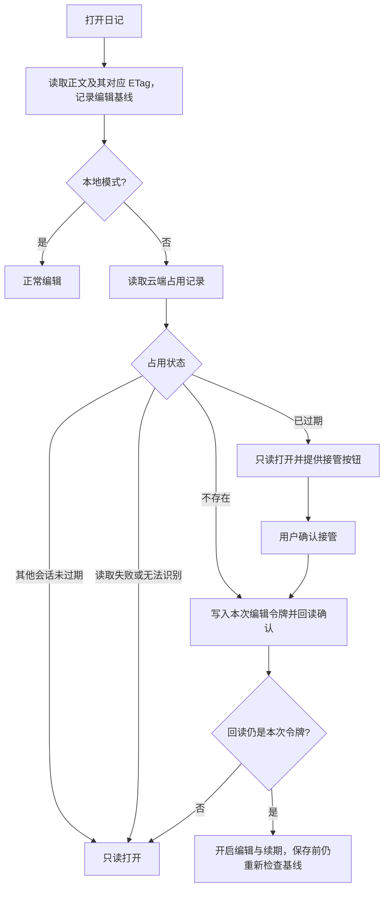
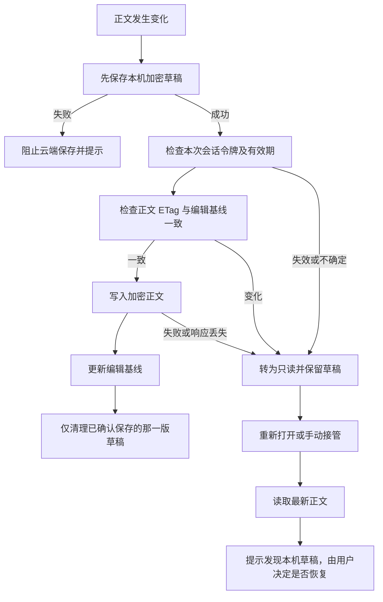
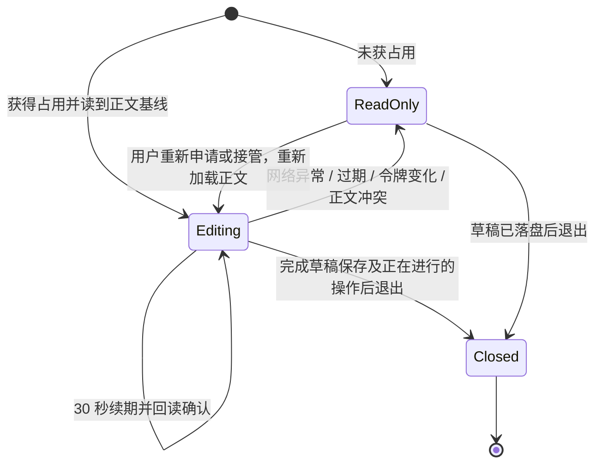
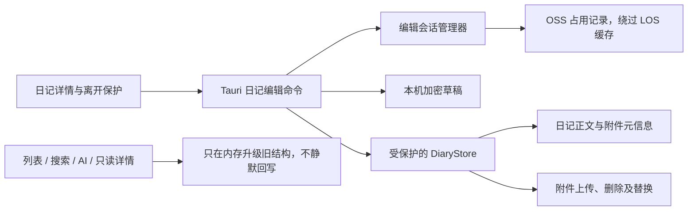

# 日记编辑占用与草稿保护

状态：第一版已实现。此模块只协调云同步模式下的日常编辑，不改变日记正文的数据版本。

## 边界

- 占用记录与日记主文件分开；不记录读者或设备名称。其他设备可以只读打开。
- 编辑设备每 30 秒续期，占用有效期为 2 分钟。过期不会自动接管，必须由用户确认。
- 网络失败、占用丢失或正文版本变化时停止云端写入，未保存正文保留为本机加密草稿。
- 本地模式不需要跨设备占用。草稿不参与云同步，也不作为可淘汰的附件缓存。
- 开启云同步时的整库上传、整库改密仍遵循其原有独占操作前提：先退出其他设备。这些整库流程不等价于逐篇编辑占用。
- **这不是严格的分布式锁**：OSS PutObject 不支持目标对象的 If-Match 条件写入，启用或暂停版本控制后禁止覆盖头也不能保证互斥。检查与写入间仍存在窄并发窗口；旧版客户端也不会遵守占用。需要严格保证时应改用支持条件提交的协调服务或独立冲突版本，本版不实现。

## 打开与接管

## 保存与恢复

恢复草稿不是自动覆盖：先展示最新日记，再由用户确认恢复。草稿清理必须比较草稿版本，不能用旧保存结果删除更新的草稿。

打开时发现草稿会暂时禁用编辑，避免新输入覆盖尚未决定如何处理的草稿。若云端日记被删除或暂时不可读，列表中的“本机草稿”入口仍可打开只读草稿，通过“复制 Markdown”另建日记；不会偷偷重建已经删除的云端对象，缺少的附件元信息也不虚构。

## 续期、退出与后台恢复

移动端恢复前台后不能依赖暂停前的计时器和内存状态；保存路径仍须重新检查云端占用和正文基线。释放只作用于自己的令牌，不能删除接管者的记录。释放与续期的网络写入同样受 OSS 非原子条件写入限制。

## 模块职责与写入覆盖

正文自动保存、删除日记、附件新增/替换/删除/重命名、音波等静默元信息更新均属于写操作。只禁用编辑器不足以保护这些入口，必须在后端校验。附件下载和本地缓存不需要编辑占用。

占用文件是临时控制对象：不加入日记附件列表、不迁移为业务数据、不重新加密为永久数据。改密与本地草稿的协调必须避免产生无法解密的草稿。

## 实际数据与代码入口

- 云端占用：`diaries/{diary_id}/edit-lock.json`，集中由 `ObjectLocations` 定义；`version`、`diaryId`、128 位随机 `token`、`expiresAt`。没有正文、密钥或设备名称，使用明文 JSON，不把一次性编辑令牌误当作安全认证凭证。
- `expiresAt = 0` 表示正常释放，下次可以直接申请。异常过期（包括本机自己的过期占用）必须手动确认接管。
- 有效期以 OSS 响应的 `Date` 为准，本机再用单调时钟限制一次确认后的最长存活时间；不依赖两台设备的 UTC 时钟同步。
- 本机草稿：应用配置目录下的 `diary-drafts/{diary_id}.enc`，AES-GCM 加密，内容包含独立格式 `version`、`diaryId`、随机 `revision`、`savedAt` 与结构化 `content`。同步文件前先 `sync_all`，再原子替换，不先删除旧草稿。单份草稿序列化上限为 16 MiB。
- `diaries/edit_lease.rs`：申请、续期、释放、过期检查和基线校验；`AppState` 共享会话，但后台任务在入队前固定写入资格。
- `diaries/diary_store.rs`：云端正文、附件删除/替换和 multipart 最终提交的检查入口；正文写入成功后推进同一会话的 ETag 基线。
- `diaries/draft.rs`：加密草稿保存、读取、列举和按 revision 清理；草稿不随 LOS 位置切换，也不会被附件缓存淘汰。
- `diaries/edit_command.rs`：编辑详情、续期、释放、草稿管理命令；原正文保存命令另外要求会话令牌和已落盘草稿。
- `useDiaryCore.ts`：先落盘草稿，再做 1 秒合并的云端自动保存；失败停止云端重试。任务携带原日记 ID 与原会话令牌，不读取之后变化的全局 ID。
- `DiaryDetail.vue`、`TiptapEditor.vue`、`useDiaryLeaveGuard.ts`：只读提示、接管确认、草稿决策、编辑器/附件菜单禁用与退出保护；预览、复制、播放和下载仍可用。
- `DiaryList.vue`：单独列出本机未处理草稿，不把草稿混入远程日记分页或 AI 可读取的数据中。

只读读取的旧结构仅在内存迁移，后续真正编辑保存时才发布。正文与 ETag 从同一次 GET 获取，不能下载后再 HEAD 组合两个时间点的快照。

改密预检查及真正启动时都拒绝遗留的本机草稿，先要求用户恢复或放弃；云端临时占用文件不纳入业务数据重加密。占用丢失、升级版本不匹配、损坏草稿均不自动删除或覆盖。

## 验证清单

- 无占用、有效他人占用、他人及本机过期手动接管、续期、释放、回读令牌不符。
- 旧会话失效后不得借用新会话资格写入；正文基线变化停止保存。
- 草稿加密、原子替换、保存失败、旧回执不清除新草稿、重启恢复。
- 只读打开不会触发迁移或音波等云端静默回写。
- 前端退出、切换日记、后台恢复和上传期间的状态切换。
- `surkaa-test` 唯一测试前缀真实 OSS 集成测试；通过后清理，失败时保留诊断对象。

已覆盖协议单元测试、本机磁盘失败/损坏/重启测试、真实 OSS 的只读迁移/连续保存/基线变化/旧上传中止/云端删除后草稿恢复，以及前端自动保存/旧回执/退出/手动接管测试。编辑器只读菜单在浅色、深色和 Windows、Android 平台分支下均有 DOM 测试。自动化测试不替代两台真实设备的后台挂起、断网和恢复手工验收。

## OSS 能力依据

- [PutObject 不支持这些条件请求头](https://help.aliyun.com/zh/oss/user-guide/0017-00000245)。
- [PutObject 的禁止覆盖与版本控制限制](https://www.alibabacloud.com/help/zh/oss/developer-reference/putobject)。

这些限制意味着测试只能验证协作客户端遵守本协议，不能据此声称严格互斥。
