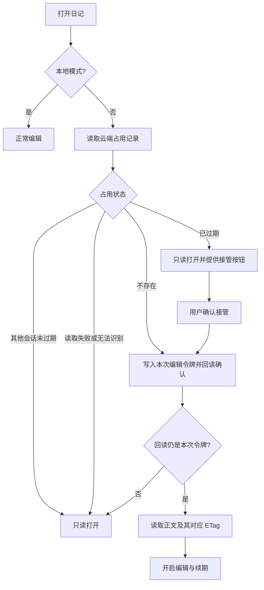
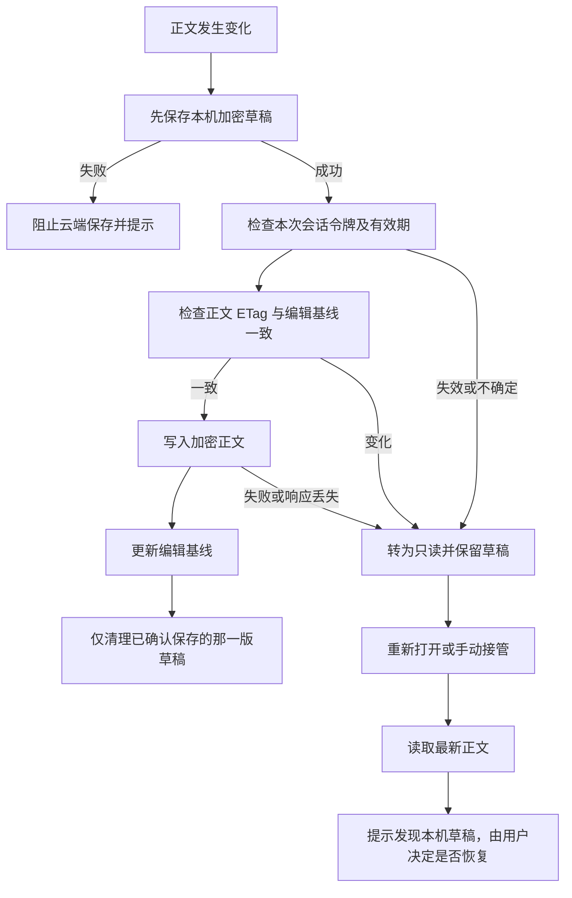
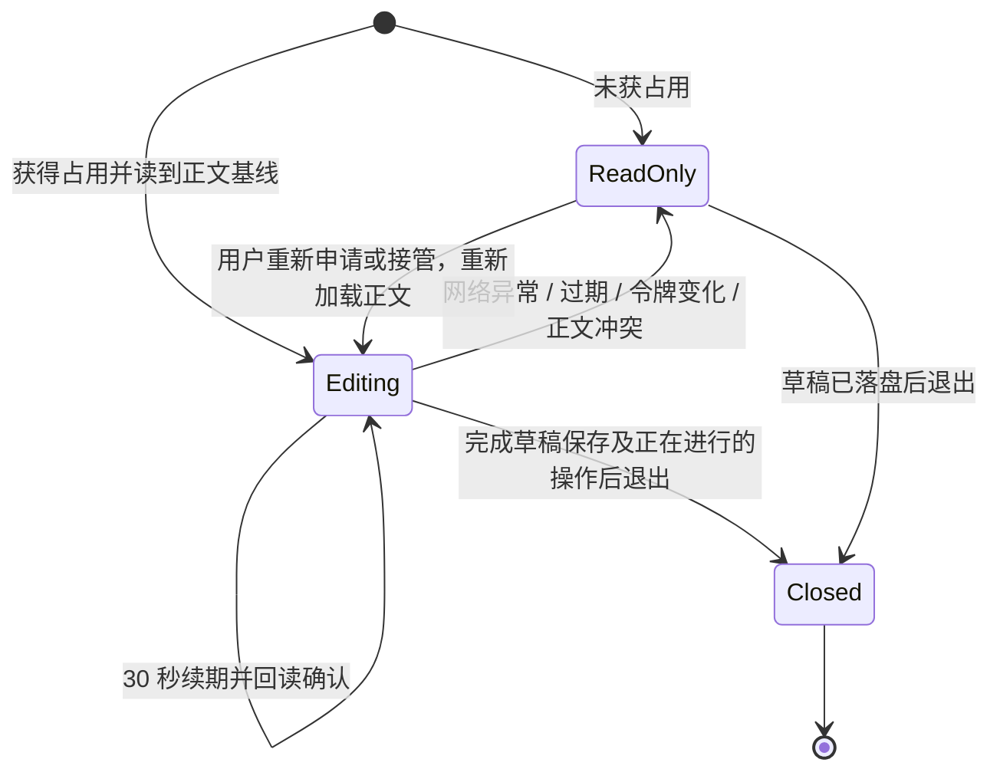
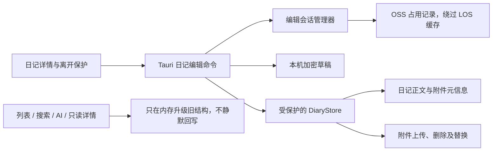

# 日记编辑占用与草稿保护

状态：实施中。此模块只协调云同步模式下的编辑，不改变日记正文的数据版本。

## 边界

- 占用记录与日记主文件分开；不记录读者或设备名称。其他设备可以只读打开。
- 编辑设备每 30 秒续期，占用有效期为 2 分钟。过期不会自动接管，必须由用户确认。
- 网络失败、占用丢失或正文版本变化时停止云端写入，未保存正文保留为本机加密草稿。
- 本地模式不需要跨设备占用。草稿不参与云同步，也不作为可淘汰的附件缓存。
- **这不是严格的分布式锁**：OSS PutObject 不支持目标对象的 If-Match 条件写入，启用或暂停版本控制后禁止覆盖头也不能保证互斥。检查与写入间仍存在窄并发窗口；旧版客户端也不会遵守占用。需要严格保证时应改用支持条件提交的协调服务或独立冲突版本，本版不实现。

## 打开与接管

## 保存与恢复

恢复草稿不是自动覆盖：先展示最新日记，再由用户确认恢复。草稿清理必须比较草稿版本，不能用旧保存结果删除更新的草稿。

## 续期、退出与后台恢复

移动端恢复前台后不能依赖暂停前的计时器和内存状态；保存路径仍须重新检查云端占用和正文基线。释放只作用于自己的令牌，不能删除接管者的记录。释放与续期的网络写入同样受 OSS 非原子条件写入限制。

## 模块职责与写入覆盖

正文自动保存、删除日记、附件新增/替换/删除/重命名、音波等静默元信息更新均属于写操作。只禁用编辑器不足以保护这些入口，必须在后端校验。附件下载和本地缓存不需要编辑占用。

占用文件是临时控制对象：不加入日记附件列表、不迁移为业务数据、不重新加密为永久数据。改密与本地草稿的协调必须避免产生无法解密的草稿。

## 验证清单

- 无占用、有效他人占用、过期手动接管、续期、释放及损坏记录。
- 旧会话失效后不得借用新会话资格写入；正文基线变化停止保存。
- 草稿加密、原子替换、保存失败、旧回执不清除新草稿、重启恢复。
- 只读打开不会触发迁移或音波等云端静默回写。
- 前端退出、切换日记、后台恢复和上传期间的状态切换。
- `surkaa-test` 唯一测试前缀真实 OSS 集成测试；通过后清理，失败时保留诊断对象。

## OSS 能力依据

- [PutObject 不支持这些条件请求头](https://help.aliyun.com/zh/oss/user-guide/0017-00000245)。
- [PutObject 的禁止覆盖与版本控制限制](https://www.alibabacloud.com/help/zh/oss/developer-reference/putobject)。

这些限制意味着测试只能验证协作客户端遵守本协议，不能据此声称严格互斥。
