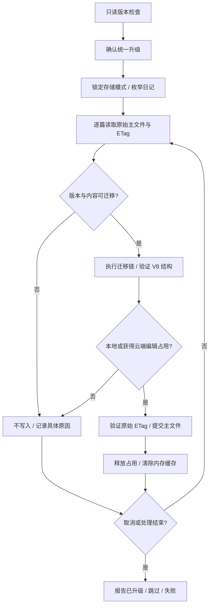

# 折叠章节（V8）

## 结构与迁移

- 日记版本从 V7 升为 V8；原 `summary.content: string` 迁移成一个 Markdown 子节点，字符串原样保留，包括空字符串、代码块和表格。
- `content` 现在是 `SummaryContentNode[]`，仅允许 Markdown、位置、图片、音视频、文件和相册。该枚举不包含 Summary，后端反序列化拒绝嵌套。
- 迁移沿用已有读取/编辑占用流程，不下载或移动附件，不改变日记 ID、附件 ID、创建时间或修改时间。旧客户端不支持 V8，使用同一 Vault 的设备应一起升级。

## 编辑器结构

- Summary 是编辑器父节点，具有可编辑的 `summaryTitle` 与 `summaryBody` 两个子节点，不再使用 atom、字符串预览或编辑弹窗。
- 标题和正文使用同一个 ProseMirror 文档、事务、撤销历史和自动保存通道。持久化仍使用应用节点，不保存 Tiptap 内部节点格式或折叠展开状态。
- 日记顶层允许 Summary；正文只允许普通文本块和附件块，不允许 Summary。列表和表格仍不允许附件或 Summary 作为内部文本块。

## 操作边界

1. 点击折叠按钮原地创建章节；有选区时保留格式和附件。存在其他章节时可从现有平台菜单选择新建或追加到已有章节。
2. 点击三角只展开/收起，不唤起移动端键盘。点击标题或正文可直接编辑。
3. 标题 Enter 进入正文；正文最后一个空段落 Enter 离开章节。也可以点击“在下方继续正文”。
4. “取消折叠，保留内容”将标题和正文平铺回来；标题开头 Backspace 不删除整个章节。
5. 内部调整块顺序仅调整当前正文，不移动标题和外部内容。图集创建、拆分、展示方式及图片插入支持内部节点；不能把不同章节的图片误合为一个图集。
6. 拒绝向章节内部粘贴其他章节；普通粘贴、列表、表格按编辑器原有规则处理。

## 派生数据与安全

- 搜索、附件类型筛选、附件计数、AI 读取、未使用附件检测和 Markdown 导出都遍历内部节点，不能把隐藏附件当成未使用附件删除。
- 旧字符串中的任意原始 HTML 不会因迁移变成活动 HTML；正文编辑器自身保存的无属性 `<u>` 用于下划线，其他 HTML 作为文字处理，远程 Markdown 图片不自动加载。
- 只读日记可以展开和复制内容，但不提供编辑、追加或取消折叠操作。

## 设置中的统一升级

- “日记数据版本”仍先执行只读检查；发现旧版后提供“统一升级”，确认旧客户端兼容风险后才开始写入。
- 从存储中的原始主文件执行现有 V4→V8 迁移链，验证当前结构后重新加密，只写主文件，不改变时间或附件。不能以已经迁移的内存缓存代替真实升级。
- 云端逐篇申请编辑占用，跳过本机正在编辑、其他设备占用及异常过期的日记；写入前复用原始 ETag 检查。沿用轻量占用的并发边界，不宣称严格互斥。
- 当前版与更高版不重写；无迁移链、损坏数据、占用等分别列出原因（最多 20 项）。
- 取消在完整的单篇操作之间生效，保留已完成升级；再次运行只处理剩余旧版。中断后重新检查即可确认真实结果。

